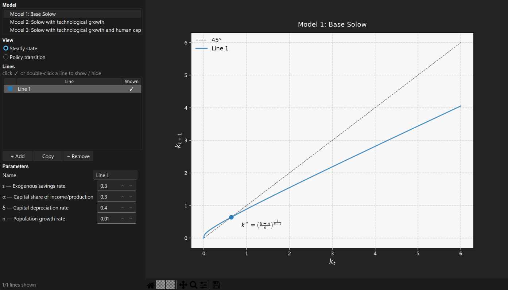
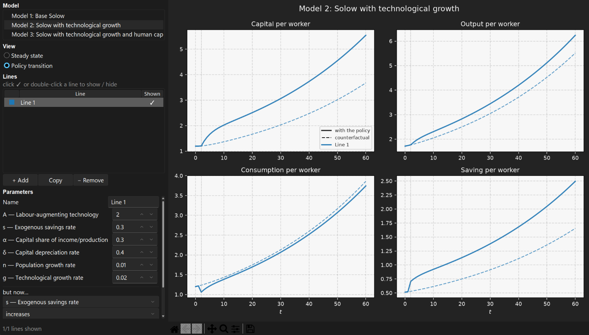

# Solow Model Visualizer

A desktop app for exploring neoclassical economic growth models visually. You can pick a model, add as many lines as you'd like, edit each line's parameters, and the plot will redraw as you type. The point of this small program is to make it easier (predominantly for economics students) to visualize how, in Solow-based models, each parameter and related policy shocks impact the economy (e.g. how does faster population growth or a lower savings rate change the economy's growth path?).

Each model offers two views:

- **Steady state**: a 45-degree diagram of the law of motion, with each line's
  steady state marked.



- **Policy transition**: capital, output, consumption and saving over time
  after a parameter changes in a chosen period, drawn against the path the
  economy would have followed without the change.



Built with Tkinter and matplotlib, themed with sv-ttk.


## Platform support

The app has been developed and tested on **Windows** only. It has not and will not be tested on macOS or any Linux distribution. It may run there, but expect issues (mainly visual) that I do not personally care to solve.

## Models

| Model | Law of motion |
| --- | --- |
| Base Solow | $k + s\cdot k^{α} − (δ+n)\cdot k$ |
| Solow with labour-augmenting technology | $k + A \cdot [s \cdot \frac{k}{A}^{α} − (δ+g+n)\cdot \frac{k}{A}]$ |
| Solow with technology and human capital | as above with $A \cdot h$, where $h = e^{ψu}$ |

## Running it

Install the dependencies noted in requirements.txt. Then either run `solow_visualizer/main.py` directly, or from the repository root like so:

```
python -m solow_visualizer.main
```

## Files

All code lives in the `solow_visualizer/` folder.

| File | What it does |
| --- | --- |
| `main.py` | The app itself: builds the window, the sidebar (model list, lines, parameter editor) and the plot area, and redraws when anything changes. Run this file to start the program. |
| `registry.py` | The registry that connects the app and the models: parameter descriptions, lines, policy shocks and the list of available models. |
| `simplesolow.py` | The base Solow model. |
| `solowtech.py` | The Solow model with labour-augmenting technology. |
| `solowtechhcap.py` | The Solow model with technology and human capital. |
| `diagram.py` | Drawing code for the 45-degree steady-state diagrams, shared by all models. |
| `transition.py` | Simulates and draws the policy transition view, shared by all models. |
| `__init__.py` | Marks the folder as a Python package and makes the window render sharply on scaled Windows displays. |
